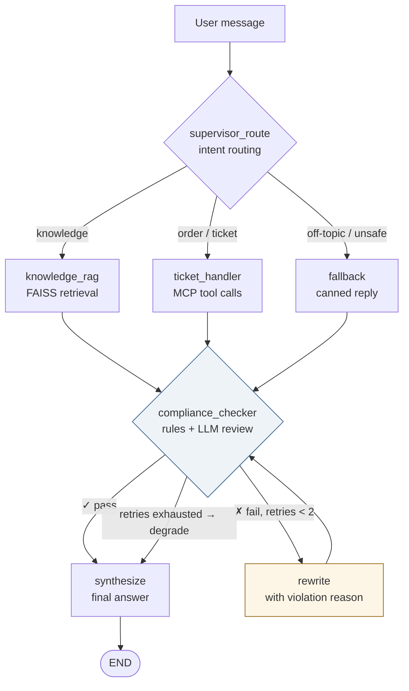

# Your First Multi-Agent Project

<p align="center">
  <a href="https://github.com/Keviniscool-boy/agents-on-duty/actions/workflows/ci.yml"></a>
  
  
  <a href="LICENSE"></a>
</p>

<p align="center">
<a href="README.md">简体中文</a> | English
</p>

> A smart customer-service system: Supervisor orchestration + compliance repair loop + three-tier memory with graceful degradation · FastAPI + LangGraph + MCP

A customer-service agent system built with **FastAPI + LangGraph**, designed as a **simple, readable, production-minded** first multi-agent project: no clever abstractions — every module maps to an engineering problem you hit in real business: routing, compliance, idempotency, degradation, auth, observability.

## What it does

Users ask questions in natural language; the system routes each turn to the right agent:

- 📚 **knowledge_rag** — refund policies, onboarding, product FAQ, answered via FAISS vector retrieval
- 🎫 **ticket_handler** — order/logistics lookup and ticket creation via **MCP** tool calls
- 🛡️ **compliance_checker** — rule-based + LLM review: PII leaks, profit guarantees, prompt leakage
- 🔄 **compliance repair loop** — failed answers are **rewritten with the violation reason** (max 2 retries), then degrade to a fallback script
- 💬 **fallback** — politely refuses off-topic, dangerous, or system-probing requests

## Architecture



## Three-tier memory, three-level degradation

Every piece of data has a clear owner and a degradation path:

| Data | First choice | Fallback | Notes |
|---|---|---|---|
| Chat history | Redis (30 min TTL) | MySQL → in-process | includes user_id / session_id |
| Routing / compliance context | Redis (24 h) | MySQL → in-process | working memory |
| Users, session ownership | SQLite | — | PBKDF2 hashing + JWT auth |
| LangGraph checkpoints | AsyncSqliteSaver | in-process | survives restarts |
| Ticket idempotency | SQLite | — | semantic keys; duplicates return the original ticket |
| Orders / logistics | **not stored** — queried live via MCP | — | order data stays in the order system |

- **MySQL is a hard dependency**: startup self-check fails → the app refuses to boot
- **Redis going down only makes it slower**: automatic degradation to MySQL, no downtime
- Everything persisted to MySQL carries `user_id` for auditability

## Quick start

```bash
# 1. Configure environment
cp .env.example .env
#    At minimum: OPENAI_API_KEY / OPENAI_BASE_URL / MODEL_NAME
#    and MYSQL_PASSWORD (docker compose initializes MySQL with it)

# 2. One command for the whole stack (MySQL + Redis + backend + frontend)
docker compose up --build

# 3. Open http://localhost:8080, register an account, start chatting
```

For manual deployment see [Dockerfile](Dockerfile) and the comments in `.env.example`.

## Project layout

```
agents/          5 agents: supervisor routing, knowledge_rag, ticket_handler,
                 compliance_checker, synthesizer + the rewrite node
api/             FastAPI: /api/chat, /api/chat/stream (SSE), /api/auth/*, /api/tools, /api/metrics
memory/          three-tier memory: short_term, working_memory, long_term (FAISS)
storage/         MySQL fallback store (working context / history / messages)
mcp_client/      MCP client with network retry and local fallback
mcp_tools/       MCP server: order_query / ticket_create / risk_check
tools/           local fallback tools + ticket idempotency store (SQLite)
auth/            JWT signing + SQLite user database
tracing/         OpenTelemetry setup + per-agent metrics
frontend/        React + Vite: sessions, live SSE progress, agent trace chips, ops panel
evaluation/      8 evaluation scripts: routing / RAG / compliance / MCP / memory / auth + locust
```

## Design decision FAQ

**Q: Why is the ticket idempotency key a content fingerprint (user + title + description hash) instead of a request ID?**
A request ID changes on every tool call — it survives network retries but not "the user asks again". A content fingerprint returns the original ticket ID on duplicate submission, which in customer service is better UX anyway. See `build_idempotency_key` in `agents/ticket_handler.py`.

**Q: Why is MySQL a hard dependency while Redis is allowed to fail?**
Redis is a hot cache; when it dies we degrade to MySQL and just get slower. MySQL is the system of record — if it's gone there is nowhere to land any context, so fail fast at startup.

**Q: Why must the LangGraph checkpointer be AsyncSqliteSaver?**
A real bug we hit: every API goes through `ainvoke`/`astream`, and the sync `SqliteSaver` raises `NotImplementedError` on async methods — the graph compiles fine, then the first chat crashes. Lesson: **a graph that compiles is not a graph that runs**; test at the graph level (see `test_compliance_loop.py`).

**Q: Why aren't orders persisted in this system?**
The CS system is a pass-through: query via MCP, put the result in the answer, drop it. The order system is the single source of truth; caching orders here only creates consistency problems.

**Q: Why SSE instead of WebSocket for streaming?**
Chat streaming is one-directional (server → client events). SSE rides plain HTTP, reconnects automatically, and `graph.astream(stream_mode="updates")` is already an event generator — a perfect match.

**Q: Why "rules first, LLM second" for compliance?**
Regex PII / forbidden-term checks are deterministic: free, false-positive-free, millisecond-fast. The LLM only reviews semantic risks after rules pass. High-risk rule hits short-circuit before any LLM call. See `full_check` in `agents/compliance_checker.py`.

## Testing

```bash
pip install -r requirements-dev.txt
python -m pytest
```

17 tests cover the compliance loop (graph-level, FakeLLM-driven), ticket idempotency,
memory degradation chains, login rate limiting, and MySQL storage. MySQL-dependent cases
auto-skip when no server is reachable. `evaluation/` contains end-to-end scripts that
run against a live service.

## Tech stack

Python 3.12 · FastAPI · LangGraph · LangChain · MCP · MySQL · Redis · SQLite ·
FAISS · React · Vite · JWT · OpenTelemetry · Docker Compose

## License

[MIT](LICENSE)
