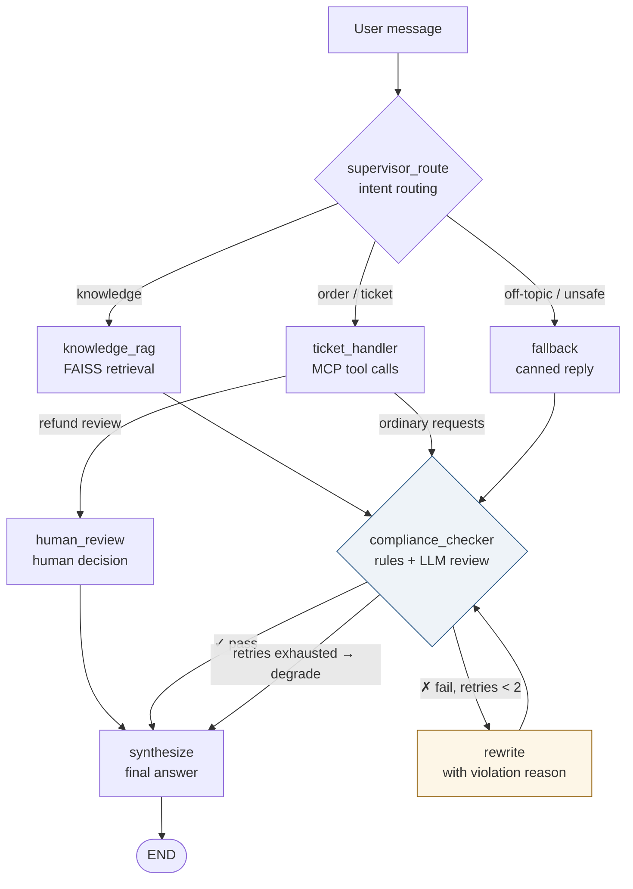

<div align="center">

# Agents on Duty

_A LangGraph customer-service agent with human handoff and recoverable after-sales workflows_

[](https://www.python.org)
[](https://langchain-ai.github.io/langgraph/)
[](https://react.dev)
[](https://docs.docker.com/compose/)

[About](#-about-this-project) · [Quick Start](#-quick-start) · [Architecture](#-architecture) · [Highlights](#-why-its-worth-reading) · [Design FAQ](#-design-decision-faq)

[简体中文](README.md) | **English**

</div>

---

## 📖 About this project

Agents on Duty is a runnable customer-service agent learning project. It answers knowledge-base questions, looks up demo orders, and accepts refund requests. When a request needs a person, the conversation pauses for a support agent and continues after their decision.

Customers can view their orders and requests. Support agents can review the handoff, ask for more information, and approve or reject a request from the workbench.

> **Demo scope:** Orders and refunds use simulated data. Approval does not execute a real refund. The knowledge base, compliance rules, and authorization need further work before production use.

## 🎯 Why it's worth reading

- **After-sales requests:** Account-scoped demo orders, refund applications, cancellation, and idempotent retries.
- **Human workbench:** Review the request and conversation, ask for more information, approve, or reject.
- **Pause and resume:** A chat workflow pauses for review; a failed resume can be retried from the workbench.
- **Knowledge answers:** Answer from local documents with requested source citations and show a fallback when embeddings are unavailable.
- **Orchestration and resilience:** Supervisor routing, compliance checks, MCP tools, storage fallback, and SSE progress.

## 🚀 Quick Start

> [!TIP]
> You need Docker, an OpenAI-compatible chat model, and an embedding service — set `DASHSCOPE_API_KEY` for the Aliyun-native path, or leave it empty to reuse `OPENAI_BASE_URL` with any OpenAI-compatible endpoint.

```bash
# 1. Configure the environment
git clone https://github.com/Keviniscool-boy/agents-on-duty.git
cd agents-on-duty
cp .env.example .env
#    Edit .env — at minimum:
#    OPENAI_API_KEY / OPENAI_BASE_URL / MODEL_NAME
#    Embedding credentials (DASHSCOPE_API_KEY or a compatible endpoint),
#    MYSQL_PASSWORD, and JWT_SECRET_KEY
#    Set FRONTEND_PORT=8081 if port 8080 is occupied

# 2. Start everything
docker compose up --build -d

# 3. Open http://localhost:8080 (or your FRONTEND_PORT), register, and chat
```

### Try human handoff

1. Register and sign in, then open **Orders & after-sales** to see your demo orders.
2. Run `docker compose exec app python -m auth.bootstrap_admin <username>` and refresh the page to open the support workbench.
3. Request a refund in chat or from the orders page, then review it in the workbench.

Chat requests pause the agent workflow; requests created directly on the orders page have no chat thread to resume. See [After-sales workflow](docs/after-sales.md) for roles and recovery.

## Next steps

Improve administration and audit, knowledge versioning and permissions, and real business-system integration. A Pi knowledge-assistant experiment remains under consideration. See the [roadmap](docs/optimization-roadmap.md).

Try these three questions and watch the agent trace chips under each reply:

| You ask | Who answers | What you see |
|---|---|---|
| "How many days after delivery can I return an item?" | 📚 Knowledge RAG | FAISS retrieval → compliance pass |
| "Show my orders" | 🎫 Ticket handler | MCP tool call → compliance check |
| "Write me a novel" | 💬 Fallback | polite refusal |

Each account receives isolated demo orders. Eligible orders can be submitted for review as refund requests; no real payment or refund is performed.

<details>
<summary><b>Manual setup without Docker</b></summary>

```bash
# Backend (Python 3.12+, needs local MySQL and Redis)
pip install -r requirements-dev.txt
uvicorn api.main:app --port 8000

# Frontend
cd frontend && npm install && npm run dev   # http://localhost:5173
```

See `.env.example` for a per-variable explanation.
</details>

## 🏗️ Architecture



## 🧠 Three-tier memory, three-level degradation

> [!NOTE]
> The most instructive part of this project: **every piece of data has an explicit owner and explicit failure semantics**.

| Data | First choice | Fallback | Lifetime |
|---|---|---|---|
| Chat history | Redis (30 min TTL) | MySQL → in-process | short-term |
| Routing / compliance context | Redis (24 h TTL) | MySQL → in-process | per-session |
| Users, session ownership | SQLite | — | permanent |
| LangGraph checkpoints | AsyncSqliteSaver | startup fails | Persisted to SQLite |
| Ticket idempotency | SQLite | — | permanent |
| Demo orders / refund requests | SQLite | — | Account-scoped demo records |

- MySQL is the system of record → **hard dependency**; startup self-check fails → the app refuses to boot
- Redis is a hot cache → going down **only makes it slower**, no downtime
- Everything persisted to MySQL carries `user_id` / `session_id` for auditability

#### Concurrency & multi-replica (A6/A7, supported)

- **Atomic merge on the MySQL path**: context updates go through `merge_working_context` inside a transaction with `SELECT ... FOR UPDATE` row locks — concurrent workers updating different fields of the same session no longer lose updates (including gap-lock deadlock backoff, `storage/mysql_store.py`).
- **In-process fallback stays per-process**: it is only the last link of the read fallback chain; consistency comes from the Redis/MySQL tiers.
- **Deployment note**: configure Redis for multi-worker deployments to share cache and rate-limit counters; the default compose setup is single-worker.
- Redis and in-process rate-limit counters are independent; after Redis recovers, in-process counters are treated as reset.

## 🗂️ Project layout

```
agents/          5 agents + the rewrite node
api/             FastAPI: sync chat, SSE streaming, JWT auth, tools & metrics
memory/          short_term (chat) / working_memory (routing state) / long_term (FAISS)
storage/         MySQL fallback store
mcp_client/      MCP client: retry + local fallback
mcp_tools/       MCP server: order_query / ticket_create / risk_check
tools/           local fallback tools + ticket idempotency store
auth/            JWT + SQLite user database
tracing/         OpenTelemetry + agent metrics
frontend/        React + Vite: sessions, live progress, trace chips, ops panel
evaluation/      8 end-to-end evaluation scripts + locust load tests
```

## ❓ Design decision FAQ

<details open>
<summary><b>Why is the ticket idempotency key a content fingerprint instead of a request ID?</b></summary>
<br>
A request ID changes on every tool call — it survives network retries but not "the user asks again". A content fingerprint returns the original ticket ID on duplicates, which in customer service is better UX anyway. Same-content tickets are accepted only once — a deliberate trade-off.
<br><br><code>agents/ticket_handler.py → build_idempotency_key</code>
</details>

<details>
<summary><b>Why is MySQL a hard dependency while Redis may fail?</b></summary>
<br>
Different roles: Redis is a hot cache — when it dies we degrade to MySQL and just get slower. MySQL is the system of record — if it's gone, no context can land anywhere, so fail fast instead of running degraded.
<br><br><code>storage/mysql_store.py → self_check</code>
</details>

<details>
<summary><b>Why must the LangGraph checkpointer be AsyncSqliteSaver?</b></summary>
<br>
A real bug we hit: every API goes through <code>ainvoke</code>/<code>astream</code>, and the sync SqliteSaver raises <code>NotImplementedError</code> on async methods — the graph compiles fine, then the first chat crashes. Lesson: <b>a graph that compiles is not a graph that runs</b>. Test at the graph level (see <code>test_compliance_loop.py</code>).
</details>

<details>
<summary><b>Where are demo orders stored?</b></summary>
<br>
Demo orders and refund requests are stored in SQLite. A real integration should treat the external order system as the source of truth.
</details>

<details>
<summary><b>Why SSE instead of WebSocket for streaming?</b></summary>
<br>
Chat streaming is mostly one-directional (server → client). SSE rides plain HTTP and reconnects automatically, and <code>graph.astream(stream_mode="updates")</code> is already an event generator — a perfect match.
</details>

<details>
<summary><b>Why "rules first, LLM second" for compliance?</b></summary>
<br>
Local regex checks catch common PII patterns and fixed forbidden terms before an LLM call. They can falsely match ordinary numbers and miss other expressions. The LLM reviews responses that pass those rules.
<br><br><code>agents/compliance_checker.py → full_check</code>
</details>

## ✅ Testing

```bash
pip install -r requirements-dev.txt
DASHSCOPE_API_KEY=dummy-key-for-ci python -m pytest -q
```

Automated tests cover refund rules and idempotency, human handoff and recovery, access isolation, compliance, and knowledge-base degradation. Graph tests use fake models and do not execute real refunds.

| Area | Main test file |
|---|---|
| Refund rules, isolation, idempotency | `test_after_sales.py` |
| Human handoff, recovery, roles, concurrency | `test_human_in_the_loop.py` |
| Embedding degradation | `test_embedding_degradation.py` |
| Compliance and rewriting | `test_compliance_loop.py` |

> [!NOTE]
> Tests requiring MySQL explicitly skip when it is unavailable. CI starts an isolated MySQL service for those tests.

<details>
<summary><b>End-to-end evaluation</b></summary>

The 8 scripts in `evaluation/` run against a live service: routing accuracy, RAG quality,
compliance interception, MCP resilience, memory consistency, auth security, plus locust
load tests. See each script's header for usage.
</details>

## 🛠️ Tech stack

| Layer | Tech |
|---|---|
| Orchestration | LangGraph · LangChain |
| Service | FastAPI · Uvicorn · SSE |
| Tool protocol | MCP (Model Context Protocol) |
| Storage | MySQL 8 · Redis · SQLite · FAISS |
| Frontend | React 19 · Vite · native SSE |
| Observability | OpenTelemetry · custom agent metrics |
| Quality | Pytest · GitHub Actions · Locust |
| Deployment | Docker Compose · Nginx |

## 📄 License

[MIT](LICENSE) © 2026
