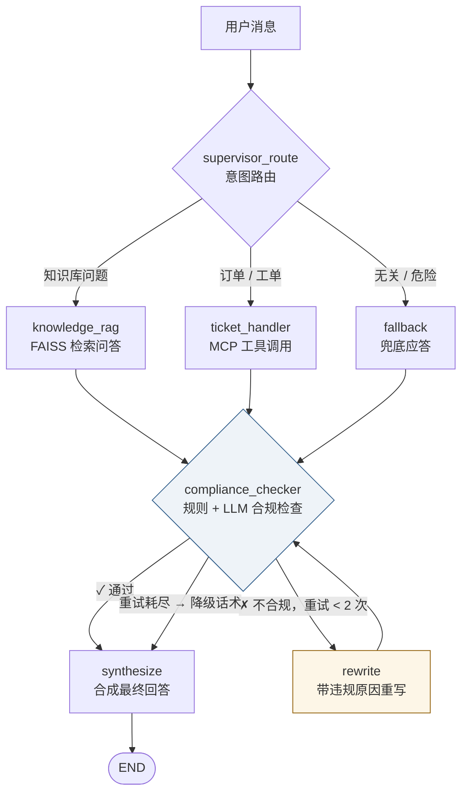

<div align="center">

# Agents on Duty

_可运行的 LangGraph 客服系统：从意图路由、RAG / MCP 工具到合规出站_

[](https://www.python.org)
[](https://langchain-ai.github.io/langgraph/)
[](https://react.dev)
[](https://docs.docker.com/compose/)

[快速开始](#-快速开始) · [看运行过程](#-一条消息如何流转) · [架构](#-系统架构) · [设计决策](#-设计决策-faq) · [测试](#-测试)

**简体中文** | [English](README.en.md)

</div>

---

## 📖 项目介绍

这是一个可运行的多 Agent 客服学习项目。用户发消息后，LangGraph 的 Supervisor 将请求分给知识库问答、订单/工单工具或兜底节点；回答经过规则和 LLM 合规检查，违规时最多重写两次，再转固定话术。React 界面通过 SSE 展示节点进度。

**适合谁：**想读懂 LangGraph 状态图、RAG 与 MCP 工具调用，以及失败后如何降级的开发者。订单和物流使用仓库内 mock 数据；合规规则与样本评测用于学习和演示，不能直接作为生产风控方案。

> [!TIP]
> **想深挖这个项目？** 完整版介绍在 [docs/project-intro.zh.md](docs/project-intro.zh.md)：
> 一条消息的 8 步完整旅程（带代码位置）· 技术选型对照表 · **面试官视角的 22 个问题与答题要点** · 三分钟开场话术。
> 可以从问题跳到相应代码，核查设计取舍。

## 🛠️ 下一步

项目正在从可运行的客服 Agent Demo，逐步建设为面向售后场景的企业化业务系统，后续将重点完善：

- 退款与售后业务流程
- Agent 人工接管与流程恢复
- 客服工作台
- 管理员平台与审计
- 带版本和来源引用的企业知识库
- Pi 知识库 Agent 实验

完整计划见 [`docs/optimization-roadmap.md`](docs/optimization-roadmap.md)。

## 🎯 为什么值得看

沿一条消息就能看到编排、工具、合规和状态存储如何配合。建议先跑起来，再从 [`agents/supervisor.py`](agents/supervisor.py) 读状态图。

- 🧭 **Supervisor 编排** —— 意图路由带确定性快路径：高频简单请求本地正则直接分流，一个 LLM 调用都省
- 🛡️ **合规修复回路** —— 不合规回答不是简单拦截，而是带着违规原因**重写**（≤2 次），耗尽自动降级兜底话术
- 🪆 **记忆降级** —— 对话和工作上下文优先 Redis，失败时尝试 MySQL，再退到进程内；MySQL 启动自检失败会阻止服务启动
- 🎫 **语义化幂等** —— 工单幂等键用「用户 + 内容指纹」而非请求 ID，防得住网络重试，也防得住"用户再说一遍"
- 🔌 **MCP 工具调用** —— stdio MCP Server 提供模拟订单数据；调用失败有限重试，再走本地工具，工单共用 SQLite 幂等记录
- 📡 **SSE 实时流式** —— `graph.astream(stream_mode="updates")` 直接映射为事件流，前端能看到 Agent 一步一步干活
- 🔐 **基础安全控制** —— JWT 鉴权（httpOnly Cookie 下发 + CSRF Origin 校验）、PBKDF2 密码哈希、登录限流、会话归属校验、基于正则的 PII 检测与脱敏
- 📊 **可观测性** —— OpenTelemetry 追踪 + 每个 Agent 的调用指标，前端自带运维面板

## 🚀 快速开始

> [!TIP]
> 需要 Docker、一个 OpenAI 兼容的聊天模型，以及一个 embedding 服务——配置 `DASHSCOPE_API_KEY` 走阿里云原生接口，或留空复用 `OPENAI_BASE_URL` 走任何 OpenAI 兼容接口。首次启动会为 `knowledge_base/` 中的文本生成向量索引。

```bash
# 1. 配置环境变量
git clone https://github.com/Keviniscool-boy/agents-on-duty.git
cd agents-on-duty
cp .env.example .env
#    编辑 .env，至少填写：
#    OPENAI_API_KEY / OPENAI_BASE_URL / MODEL_NAME
#    EMBEDDING 服务凭据（DASHSCOPE_API_KEY 或 OPENAI_BASE_URL）、
#    MYSQL_PASSWORD、JWT_SECRET_KEY
#    若 8080 已被占用，把 FRONTEND_PORT 改成 8081

# 2. 一键启动
docker compose up --build -d

# 3. 浏览器打开 http://localhost:8080（或设置的 FRONTEND_PORT）
#    注册账号后开始对话
```

## 🔎 一条消息如何流转

试试这三个问题，观察界面显示的 Agent 节点：

| 你问 | 谁来接 | 你会看到 |
|---|---|---|
| 「商品签收后几天内可以退货？」 | 📚 知识库 RAG | FAISS 检索 → 合规通过 |
| 「查询订单 1001 的状态」 | 🎫 业务办理 | MCP 工具调用 → 合规检查 |
| 「写一段小说」 | 💬 兜底应答 | 进入兜底节点 |

订单查询用于演示工具链：MCP Server 目前对传入的订单号返回固定模拟状态；MCP 失败后的本地工具才使用 [`tools/mock_data.py`](tools/mock_data.py) 中的 `1001/1002` 数据。不要用它验证真实物流准确性。

<details>
<summary><b>不用 Docker，手动部署</b></summary>

```bash
# 后端（Python 3.12+，需要本机 MySQL 与 Redis）
pip install -r requirements-dev.txt
uvicorn api.main:app --port 8000

# 前端
cd frontend && npm install && npm run dev   # http://localhost:5173
```

环境变量名见 [`.env.example`](.env.example)。本机还需启动 MySQL；Redis 不可达时可降级，但会增加访问 MySQL 的压力。
</details>

## 🏗️ 系统架构



## 🧠 三层记忆与降级

> [!NOTE]
> 对话、工作上下文和知识库是三种不同的记忆。下表也列出与它们配合的持久化数据。

| 数据 | 第一选择 | 兜底 | 寿命 |
|---|---|---|---|
| 对话历史 | Redis（30 min TTL） | MySQL → 进程内 | 短期 |
| 路由 / 合规上下文 | Redis（24 h TTL） | MySQL → 进程内 | 会话级 |
| 用户账户、会话归属 | SQLite | — | 永久 |
| LangGraph 断点 | AsyncSqliteSaver | 进程内 | SQLite 可跨重启恢复；内存兜底不可 |
| 工单幂等记录 | SQLite | — | 永久 |
| 订单 / 物流 | MCP 固定模拟结果 | 本地 mock 表 | 演示数据不写入本服务数据库 |

- MySQL 是兜底数据源 → **硬依赖**，启动自检失败直接拒绝启动
- Redis 是热缓存 → 运行中不可达时尝试 MySQL，再退进程内；内存兜底不跨进程或重启
- 所有落 MySQL 的上下文都带 `user_id` / `session_id`，可审计

#### 并发与多副本（A6/A7，已支持）

- **MySQL 路径原子合并**：上下文更新经 `merge_working_context` 在事务 + `SELECT ... FOR UPDATE` 行锁内完成，多 worker 并发写同一会话的不同字段不丢更新（含 gap-lock 死锁退避重试，`storage/mysql_store.py`）。
- **进程内副本仍按进程隔离**：它只是读取回退链的最后一环，一致性以 Redis/MySQL 层为准。
- **部署建议**：多 worker 部署配置 Redis 以共享缓存与登录限流计数；当前 compose 默认单 worker。
- 登录限流的 Redis 计数与进程内兜底计数互不相通，Redis 恢复后进程内计数视为清零。

## 🗂️ 项目结构

```
agents/          5 个 Agent + rewrite 重写节点
api/             FastAPI：同步 chat、SSE 流式、JWT 鉴权、工具与指标
memory/          short_term（对话）/ working_memory（路由状态）/ long_term（FAISS）
storage/         MySQL 兜底存储层
mcp_client/      MCP 客户端：重试 + 本地降级
mcp_tools/       MCP Server：order_query / ticket_create / risk_check
tools/           本地备用工具 + 工单幂等存储
auth/            JWT + SQLite 用户库
tracing/         OpenTelemetry + Agent 指标
frontend/        React + Vite：会话管理、实时进度、轨迹标签、运维面板
evaluation/      8 个端到端评测脚本 + locust 压测
```

## ❓ 设计决策 FAQ

<details open>
<summary><b>工单幂等键为什么用内容指纹，而不是请求 ID？</b></summary>
<br>
请求 ID 每次工具调用都变——防得住网络重试，防不住"用户再说一遍"。内容指纹让重复提交直接返回原单号，对客服场景这本来就是更好的体验。代价是同内容工单只收一次，这是有意取舍。
<br><br><code>agents/ticket_handler.py → build_idempotency_key</code>
</details>

<details>
<summary><b>为什么 MySQL 是启动硬依赖，Redis 却允许挂？</b></summary>
<br>
启动时 `self_check` 要求 MySQL 可用。运行中 Redis 读写失败会尝试 MySQL；若 MySQL 此时也失败，部分上下文暂存在进程内，重启后会丢失。
<br><br><code>storage/mysql_store.py → self_check</code>
</details>

<details>
<summary><b>LangGraph 的 checkpointer 为什么必须用 AsyncSqliteSaver？</b></summary>
<br>
一个真实的坑：所有 API 走 <code>ainvoke</code>/<code>astream</code>，同步的 SqliteSaver 不支持 async 方法——图能编译，第一次聊天就 <code>NotImplementedError</code>。教训：<b>图能 compile ≠ 能跑</b>，切 checkpointer 后必须用图级测试真正执行（见 <code>test_compliance_loop.py</code>）。
</details>

<details>
<summary><b>订单数据为什么不在系统里落库？</b></summary>
<br>
客服系统只做透传：MCP 查询 → 写进回答 → 用完即弃。订单的唯一事实源在订单系统，缓存它只会制造一致性问题。
</details>

<details>
<summary><b>流式为什么选 SSE 而不是 WebSocket？</b></summary>
<br>
客服对话以服务端单向推送为主。SSE 基于普通 HTTP、自动重连，而 <code>graph.astream(stream_mode="updates")</code> 天然就是事件生成器，两者严丝合缝。
</details>

<details>
<summary><b>合规检查为什么"规则先行，LLM 补充"？</b></summary>
<br>
正则检查可在本地快速识别常见 PII 和固定敏感词；命中时短路 LLM 审查。它可能误伤普通长数字，也无法覆盖所有表达，规则未命中时再交给 LLM 做语义检查。
<br><br><code>agents/compliance_checker.py → full_check</code>
</details>

## ✅ 测试

```bash
pip install -r requirements-dev.txt
DASHSCOPE_API_KEY=dummy-key-for-ci python -m pytest -q
```

本地复核（2026-10-26，含存储兜底修复回归）：33 passed / 1 skipped——skip 即 roundtrip 在无真实 MySQL 时的显式跳过；CI（Python 3.12 + 真实 MySQL service）中该用例真实执行。测试不发起真实 embedding 请求；运行聊天和首次建索引需要有效的 embedding 服务凭据（DashScope 或 OpenAI 兼容）。

| 模块 | 用例 | 验证什么 | 结果 |
|---|---|---|---|
| 合规修复回路 | 3 | 图级测试（FakeLLM 驱动完整 LangGraph）：一次通过、重写 2 次耗尽后降级、重写后通过 | ✅ |
| 工单幂等与限流 | 7 | 语义幂等键命中/隔离、LLM 多传参数白名单、working memory 降级、登录限流 429、AsyncSqliteSaver 创建关闭 | ✅ |
| MCP 弹性 | 3 | 本地工具与 MCP 共享幂等存储、MCP 建单幂等 | ✅ |
| MySQL 兜底与降级链 | 4 | 自检快速失败、双挂时进程内降级；MySQL 可达时做读写往返 | ✅ / 条件执行 |
| 工作记忆 | 4 | 上下文读写、历史截断、会话清理、会话隔离 | ✅ |
| 兜底链路回归 | 8 | 写入扇出（Redis+MySQL 双写）、Redis 故障后数据仍可读、SQL 执行期异常入兜底、恢复后数据可见、Redis 回切、JWT 密钥必填、降级检索同阈值 | ✅ |
| Embedding 提供商 | 5 | DashScope/OpenAI 兼容双路径选择、索引身份不一致自动重建、旧格式元数据兼容 | ✅ |

> [!NOTE]
> `test_mysql_store_roundtrip` 在 MySQL 不可达时**显式 pytest.skip**（此前是静默 return 被计为 passed，已修复）；CI 起真实 MySQL service 作门禁，skip 不允许在该环境出现。

<details>
<summary><b>端到端评测</b></summary>

`evaluation/` 下 8 个脚本对着运行中的服务实测：路由准确率、RAG 质量、合规拦截、
MCP 弹性、记忆一致性、鉴权安全，以及 locust 压测。用法见各脚本头部注释。
</details>

## 🛠️ 技术栈

| 层 | 技术 |
|---|---|
| 编排 | LangGraph · LangChain |
| 服务 | FastAPI · Uvicorn · SSE |
| 工具协议 | MCP (Model Context Protocol) |
| 存储 | MySQL 8 · Redis · SQLite · FAISS |
| 前端 | React 19 · Vite · 原生 SSE |
| 可观测 | OpenTelemetry · 自研 Agent 指标 |
| 质量 | Pytest · GitHub Actions · Locust |
| 部署 | Docker Compose · Nginx |

## 📈 真实评测记录

开发过程中对每个子系统做过参数化调优并留有[完整评测日报](docs/test-record.md)（2026-09-11），关键数字：

| 子系统 | 调优动作 | 调优前 | 调优后 |
|---|---|---|---|
| 意图路由 | 新增 `fallback` 意图，兜底条件写入路由提示词 | 66.67%（8/12） | **100%**（12/12），均延迟 24.59s/条 |
| RAG 检索 | 检索阈值 0.6 → 0.55；RAG 来源传入合规检查；补高置信度本地路由 | — | 命中率 **92%**，回答正确率 **80%**（25 样本） |
| 合规检查 | 补 PII/承诺类规则；RAG 上下文传入 LLM 审查 | — | 规则 **6/6**，API 链路 **8/8** |
| MCP 工具链 | 修复评测脚本导入路径 | — | **7/7**（验证协议与调用链，非数据准确性） |
| 三层记忆 | — | — | **7/7**。注意：当时只验证了降级与恢复过程"不崩溃"，未断言故障期数据在恢复后仍可见、Redis 也不会自动回切——这两点（数据可见性/回切）直到 2026-10-26 修复后才由回归用例真正覆盖 |
| 鉴权与会话 | 注册/重复注册/错误凭证/跨用户会话隔离 | — | **9/9** |

> [!NOTE]
> 这些是**开发期自建样本集**上的结果，样本量小（12–25 条），用于验证设计方向而非声称生产级准确率——评测脚本与样本集在 [evaluation/](evaluation/) 可复跑。订单数据为 mock，MCP 结果代表链路正确而非业务数据准确。

## 📄 License

[MIT](LICENSE) © 2026
